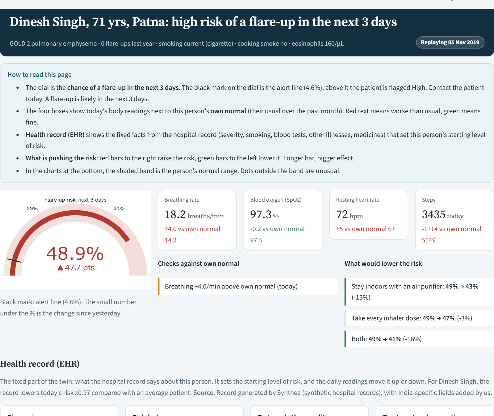
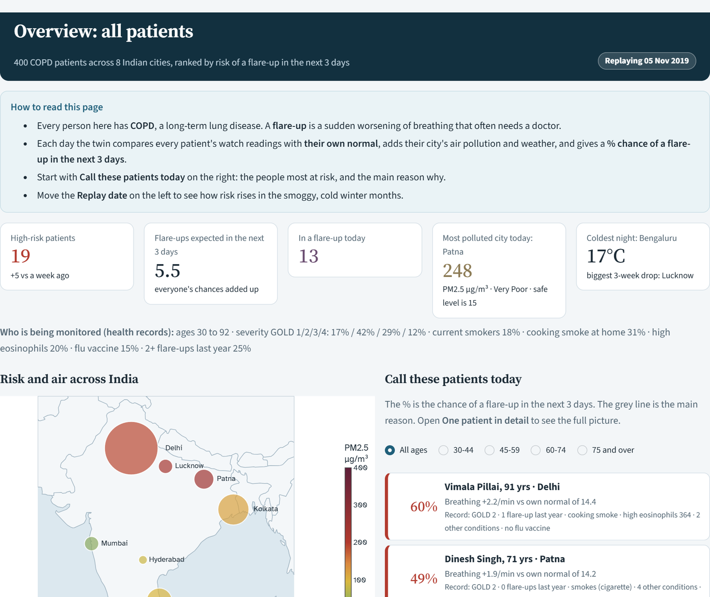
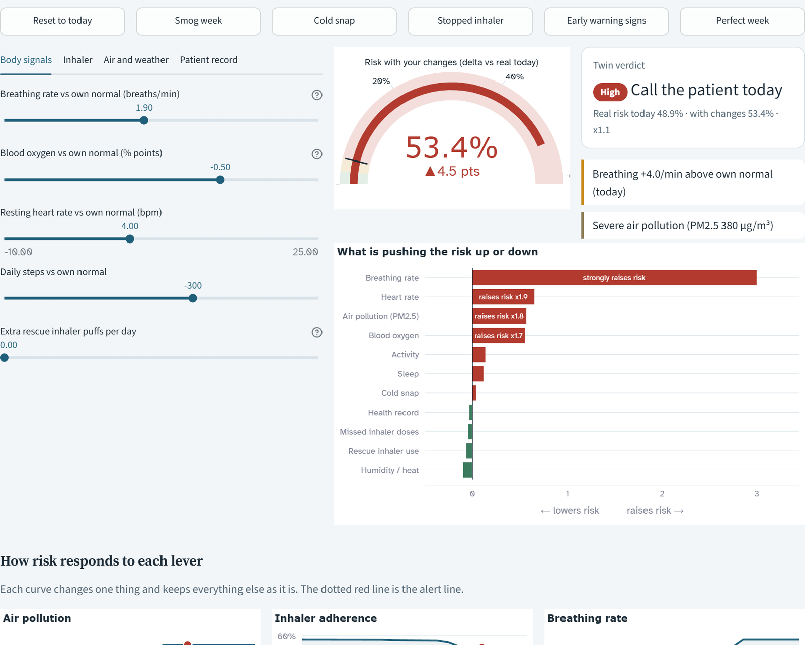
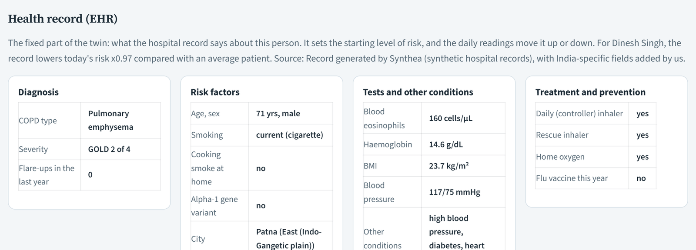
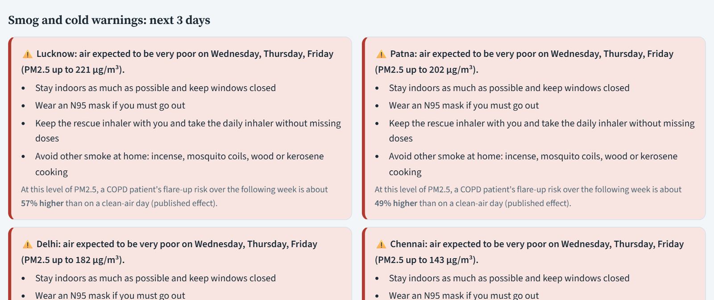
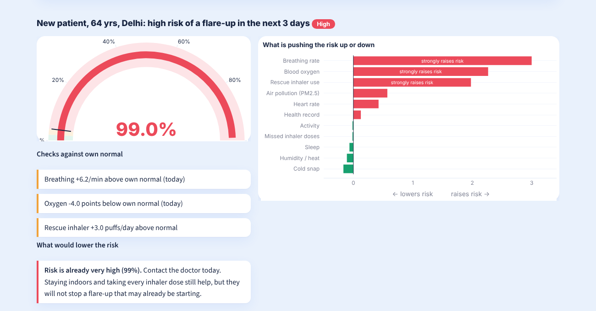
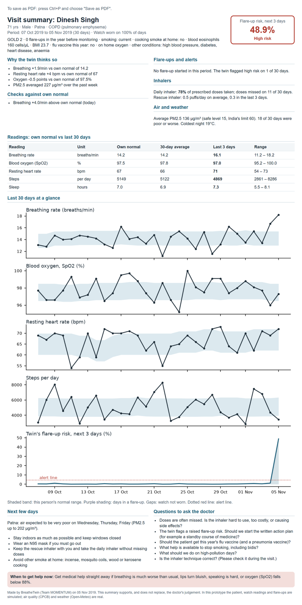
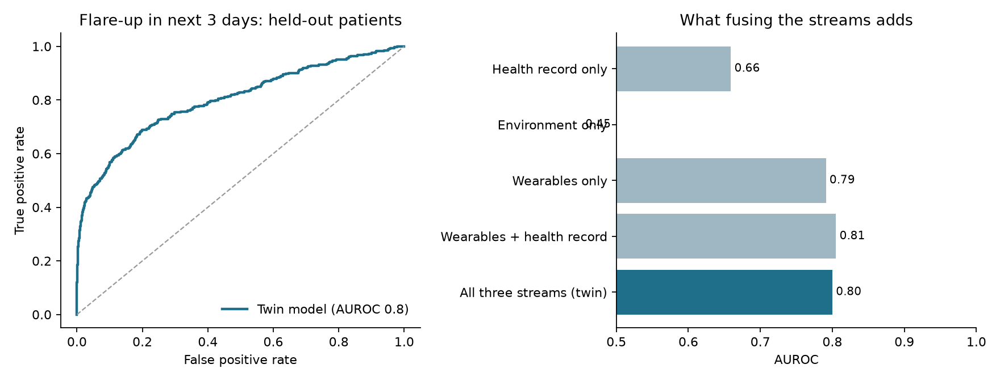

# BreatheTwin: a COPD digital twin for India

Submission to the **Digital Twin Challenge 2026** (Happiest Health, Reimagining & Reforming Healthcare in India Summit).

A digital twin of a COPD patient that learns the patient's own normal, watches their city's air pollution and weather, and warns 1 to 3 days before a likely flare-up, with the reasons, what could lower the risk, and plain advice for the family.



---

## Team details

| | |
|---|---|
| Team name | MOMENTUM |
| Team leader | Anushka Tomar |
| Member | Yash Saxena |

## College / incubator information

Both team members: SDA Bocconi Asia Center, Mumbai (MBA, IMB9, Class of 2026-28)

## Project title

BreatheTwin: an environment-aware digital twin that predicts COPD flare-ups for Indian patients

## Problem statement

COPD (chronic obstructive pulmonary disease) is one of India's largest causes of death and disability. In 2016 India had an estimated 55.3 million COPD cases, and ambient air pollution (33.6%) and household air pollution (25.8%) each accounted for more of India's COPD disability than smoking (21.0%) (India State-Level Disease Burden Initiative, Lancet Global Health 2018).

The dangerous event in COPD is the flare-up (acute exacerbation): a few days of worsening breathing that often ends in hospital. The body gives warning signs in the days before: breathing rate, heart rate and blood oxygen drift away from the patient's normal. Today nobody watches these signs between clinic visits, and nobody connects them with the smog or cold snap the patient is living through. In our replay year, Delhi's PM2.5 averaged 104 µg/m³ (about 7 times the WHO daily safe level of 15), and winter air across our 8 cities was 3 times dirtier than monsoon air.

## Healthcare use case

A pulmonologist, physician or community health worker follows a panel of COPD patients who wear a consumer smartwatch, a fingertip pulse oximeter and, optionally, a smart inhaler. Every morning the twin:

1. ranks patients by their risk of a flare-up in the next 3 days, with the main reason and key health-record facts,
2. shows, for each patient, which factors push the risk up or down (breathing above their own normal, missed inhaler doses, a week of smog, a cold snap, the health record),
3. runs transparent checks against the patient's own normal (for example "Breathing +4.0/min above own normal (today)"),
4. estimates what would lower the risk ("stay indoors with an air purifier", "take every inhaler dose"), and says plainly when the risk is already too high for that,
5. warns about smog and cold nights in the next 3 days for each city, with practical advice,
6. produces a one-page visit summary the family can print and take to the doctor,
7. lets anyone check a new person by entering their record, usual readings and readings now.

The aim is a phone call or a treatment adjustment before the hospital visit.

## What the dashboard shows

The dashboard is written for non-medical users too: every page opens with a short "How to read this page" box, risk levels say what to do (Low: no action; Medium: watch closely; High: contact the patient today), and the sidebar has a glossary of medical words.

| Page | What it does |
|---|---|
| **Overview: all patients** | Who to call today, ranked by risk, with the main reason and record facts; India map of risk and air; filter by age group; smog and cold warnings for the next 3 days |
| **One patient in detail** | Risk dial, today's readings against own normal, safety checks, what would lower the risk, full health record (EHR), what is pushing the risk, 90-day history, next-3-days advice, downloadable visit summary |
| **What-if lab** | One-click scenarios (smog week, cold snap, stopped inhaler, early warning signs, perfect week) and sliders for body signals, inhaler use, air, weather and the health record |
| **Check a new person** | Enter the record plus usual and current readings (and optionally today's PM2.5 from an AQI app); see the risk, reasons and every value the twin used |
| **How it works** | Accuracy, data sources and licences, every simulation setting with its source, real-data check |

| | |
|---|---|
|  |  |
|  |  |
|  |  |

## How it works

The prototype fuses three data streams. The brief asks for two; we add the environment because in India it is a larger cause of COPD burden than smoking.

| Stream | What it contains | Source | Real or synthetic |
|---|---|---|---|
| Static: health record | Age, sex, COPD type, severity (GOLD stage), smoking, BMI, blood pressure, other conditions, inhaler regimen, home oxygen | [Synthea](https://github.com/synthetichealth/synthea) COPD module, 300 patients aged 52-92 | Synthetic |
| Static: India overlay | 100 younger patients aged 30-51 (COPD starts earlier in India); city, cooking-smoke (biomass) exposure, bidi vs cigarette, flare-ups last year, blood eosinophils, SERPINA1 genetic marker, flu vaccination | Written by us | Synthetic, labelled |
| Dynamic: wearables | Daily resting heart rate, breathing rate, SpO2, steps, sleep, BP, rescue and controller inhaler use | Our simulator, calibrated to published studies | Synthetic |
| Dynamic: environment | Daily PM2.5 and AQI for 8 cities | CPCB data via [Kaggle "Air Quality Data in India"](https://www.kaggle.com/datasets/rohanrao/air-quality-data-in-india) (CC0) | **Real** |
| Dynamic: weather | Daily mean and minimum temperature, humidity | [Open-Meteo historical archive](https://open-meteo.com/) (CC BY 4.0) | **Real** |
| Real-data check | 100 de-identified hospital patients, 14 with COPD | [MIMIC-IV Clinical Database Demo v2.2](https://physionet.org/content/mimic-iv-demo/2.2/) (ODbL 1.0) | **Real** |

**The cohort (400 patients).** Every adult generation is represented: 40 aged 30-39, 49 aged 40-49, 62 aged 50-59, 67 aged 60-69, 79 aged 70-79 and 103 aged 80+. Synthea's lung-function value alone would make two thirds of patients GOLD 4, so we keep Synthea's ordering of who is sicker but assign stages in typical clinic shares: GOLD 1/2/3/4 = 17% / 42% / 29% / 12%. 18% currently smoke and 31% are exposed to cooking smoke at home.

Cities: Delhi, Lucknow, Patna, Kolkata, Mumbai, Hyderabad, Bengaluru, Chennai. Year replayed: March 2019 to February 2020 (a full set of seasons before the COVID-19 lockdown changed pollution). One India-wide model is trained across all eight cities; a patient from any other city is matched to the nearest monitored city.

**Why the wearable stream is simulated.** We found no open dataset of COPD patients with wearable data and labelled flare-ups. Every effect size in the simulator comes from a published study or is marked as our assumption in [`src/config.py`](src/config.py). Examples:

- Breathing rate +2.3/min two days before and +4.4/min one day before a flare-up; about 30% of flare-ups show no breathing-rate rise (Yañez 2012)
- Flare-up rates of 0.85, 1.34 and 2.00 per year for GOLD 2, 3 and 4 (ECLIPSE, Hurst 2010)
- Blood eosinophils of 340 cells/µL or more: 1.76 times more severe flare-ups (Vedel-Krogh 2016)
- Still smoking vs having quit: 1.28 times the flare-up risk (Au 2009)
- +2.5% risk per 10 µg/m³ PM2.5 (DeVries 2017)
- A 6 °C day-to-day temperature drop raising 21-day risk 1.79 times (Fu 2023)
- Cooking smoke, age, other conditions, low BMI, humidity and missed doses: direction from the literature, size is our assumption (labelled ASSUMPTION)

Health-record factors are rescaled so each GOLD stage keeps its published average flare-up rate; they shift risk between patients, not overall.

## Technical stack

- Python 3.11+, pandas, NumPy
- LightGBM (gradient-boosted trees) and scikit-learn
- Streamlit and Plotly for the dashboard
- Synthea v4 (Java) for synthetic health records
- Matplotlib for result charts and the printable visit summary

## AI/ML model and framework details

- **Task:** for each patient-day, predict whether a flare-up starts in the next 1 to 3 days.
- **Personal baseline (the twin):** for every signal, the patient's own normal is the median of days t-28 to t-8, and the spread is their own standard deviation. Features are deviations from that normal (today and 3-day average), not raw values. A new person checked on the dashboard gets a normal built from the usual readings entered.
- **Features (28 learned + PM2.5 dose-response):** body-signal deviations, rescue-inhaler use vs normal, 7-day controller adherence, cumulative temperature drop over 21 days, minimum temperature, humidity and humid-heat flag, and the health record (age, GOLD stage, past flare-ups, smoking, cooking smoke, eosinophils, other conditions, BMI, flu vaccine, home oxygen).
- **Hybrid risk engine:** a LightGBM classifier learns the body-signal, inhaler, weather and record patterns; the PM2.5 effect is not learned but taken from the published dose-response (DeVries 2017) and applied on the odds scale. Small, well-measured effects come from the literature; complex physiology comes from data.
- **Direction rules:** the model is constrained so warning signs, sharper cold, a sicker record, higher eosinophils, smoking or cooking smoke never lower risk, and taking more inhaler doses never raises it, so every what-if answer moves the sensible way.
- **Explanations:** per-patient SHAP contributions from LightGBM, grouped into plain-language factors ("what is pushing the risk up or down").
- **Rule layer:** transparent checks against the patient's own normal, on both today's reading and the 3-day average, with thresholds set just inside the published average changes.
- **Smog warnings:** the next 3 days of air quality and weather per city, using India's CPCB PM2.5 bands, with advice that gets stronger as air gets worse. In this demo the "forecast" is the real recorded data for those days of 2019-20; a live version would read an air-quality forecast.
- **Validation:** patients split 70/30, so the model is tested on 120 people it never saw (280 used for training).

### Results on held-out patients

| Measure | Value |
|---|---|
| AUROC | 0.80 |
| AUPRC | 0.24 (flare-up days are under 1% of days) |
| Flare-ups warned 1 to 3 days ahead | 66% |
| False alerts per patient per month | 0.80 |
| Published real-world range (AUROC) | 0.68 (Shah 2017) to 0.85 (Hurst 2010) |



What each data stream adds (AUROC): health record alone 0.66, environment alone 0.45, wearables alone 0.79, wearables + health record 0.81, all three 0.80. The body signals carry the 3-day warning, and the health record sets each person's starting risk. Air and weather say little about *which 3 days* a given person will flare up, because their published effects are modest; their value is in *when* risk rises across a season, in the smog warnings and in the what-if advice.

**These results come from simulated data.** They show the pipeline works and the model recovers the patterns the literature describes. They are not clinical accuracy.

### Real-data check (MIMIC-IV demo)

The record-mapping code runs on the real MIMIC-IV demo and finds 14 COPD patients. Comparing them with our synthetic cohort ([`outputs/mimic_demo_check.csv`](outputs/mimic_demo_check.csv)) shows where synthetic records differ from real ones. Sex mix (50% vs 51% male) and ischaemic heart disease (43% vs 44%) match well. Heart failure (57% vs 2%) and diabetes (64% vs 18%) do not: real hospital COPD patients are sicker than synthetic ones. Only aggregate numbers are saved.

## Demo video

> TODO: add unlisted YouTube link (15-20 minutes).

## Architecture diagram

[`docs/architecture.pdf`](docs/architecture.pdf)

## Presentation

[`docs/BreatheTwin_presentation.pdf`](docs/BreatheTwin_presentation.pdf) (PowerPoint version: [`docs/BreatheTwin_presentation.pptx`](docs/BreatheTwin_presentation.pptx))

## Open-source licence

Code: [MIT License](LICENSE). Data keeps its own licence: Synthea output (generated by Apache-2.0 software), CPCB air quality via Kaggle (CC0), Open-Meteo weather (CC BY 4.0, attribution: Open-Meteo.com), MIMIC-IV demo (ODbL 1.0; not stored in this repo, downloaded by the user).

## Run it yourself

```bash
pip install -r requirements.txt
streamlit run app/dashboard.py          # opens the dashboard at http://localhost:8501 on the included processed data
```

On Windows you can also double-click **`Open BreatheTwin.bat`**: it starts the dashboard if needed and opens it in the browser.

To open a specific view directly, add it to the address, for example `http://localhost:8501/?page=Patient%20twin&pid=MOM-0198&day=2019-11-05`.

To rebuild everything from the raw data (about 1 minute):

```bash
python run_all.py
```

Optional extras for the rebuild:

1. Download the MIMIC-IV demo zip into `data/raw/` (https://physionet.org/content/mimic-iv-demo/2.2/) to rerun the real-data check. Without it, that step is skipped and the saved comparison is kept.
2. Regenerate the Synthea cohort with the commands in [`synthea/run_synthea.md`](synthea/run_synthea.md). A trimmed copy is already in `data/raw/synthea_csv/`.

## Repository layout

```
app/dashboard.py          dashboard (Streamlit)
Open BreatheTwin.bat      Windows double-click launcher
src/config.py             every simulation setting with its source, cohort balance
src/env_data.py           real air quality + weather -> environment_daily.csv
src/ehr_synthea.py        Synthea records + India overlay + younger patients -> patients.csv
src/simulate.py           wearable stream and flare-ups (body, air, weather and record effects)
src/features.py           personal-baseline features
src/engine.py             hybrid risk engine (LightGBM x published PM2.5 effect)
src/train.py              model training, evaluation, charts
src/score_all.py          scores every patient-day for the dashboard
src/twin.py               risk, reasons, rule checks, what-if
src/advisories.py         smog and cold warnings with advice
src/visit_summary.py      printable one-page visit summary
src/mimic_demo.py         real-data check on MIMIC-IV demo
synthea/                  keep-file and exact Synthea command
data/raw, data/processed  inputs and generated tables
outputs/                  metrics and charts
docs/                     presentation, architecture diagram, screenshots
```

## Limitations

- Wearable readings and flare-ups are simulated; the model has not seen a real COPD patient's watch data.
- Synthea's COPD cohort is US-based; the India overlay, the younger patients and the stage shares are our assumptions.
- No India-specific effect size linking PM2.5 to COPD flare-ups was found; the 2.5% per 10 µg/m³ figure is a global meta-analysis.
- Cooking smoke, age, other conditions, low BMI, humidity, sleep and missed-dose effects have no published effect size and are marked as assumptions.
- Air quality is city-wide, not the patient's own exposure; the smog "forecast" replays past data.
- The dashboard needs daily readings from a smartwatch or pulse oximeter.

## Next steps

1. **Validate:** partner with a pulmonology clinic; test on real Indian COPD records and wearable data; apply for full MIMIC-IV credentialed access; tune the alert line.
2. **Patient app:** a "My lungs today" view, a daily symptom check-in that works with just a phone and a low-cost pulse oximeter, SMS/WhatsApp alerts, Hindi and regional languages.
3. **Scale:** live air-quality forecasts, link with ABHA/ABDM health records, rollout through community health workers.

## Key references

- Hurst JR et al. NEJM 2010 (ECLIPSE: exacerbation rates by GOLD stage).
- Yañez AM et al. Respir Med 2012, PubMed 22797131 (breathing rate before exacerbation).
- Hurst JR et al. 2010, PMC2978135 (pulse oximetry and heart rate before exacerbation).
- Shah SA et al. JMIR 2017;19(3):e69 (vital-sign prediction of exacerbations).
- Alahmari AD et al. BMC Pulm Med 2014;14:98 (daily steps in COPD exacerbations).
- Vedel-Krogh S et al. Am J Respir Crit Care Med 2016 (blood eosinophils and exacerbations, Copenhagen General Population Study).
- Au DH et al. J Gen Intern Med 2009 (smoking cessation and COPD exacerbation risk).
- Celli BR et al. NEJM 2004 (BODE index; low BMI and outcomes).
- Salvi SS, Barnes PJ. Lancet 2009 (COPD in non-smokers; biomass smoke).
- DeVries R et al. 2017, CDC Stacks 215891 (meta-analysis, PM2.5 and COPD exacerbation).
- Fu J et al. Front Public Health 2023;11:1112926 (temperature drop and COPD admissions, Beijing).
- India State-Level Disease Burden Initiative CRD Collaborators. Lancet Global Health 2018.
- Walonoski J et al. JAMIA 2018 (Synthea).
- Johnson A et al. MIMIC-IV Clinical Database Demo v2.2. PhysioNet 2023, doi:10.13026/dp1f-ex47.
