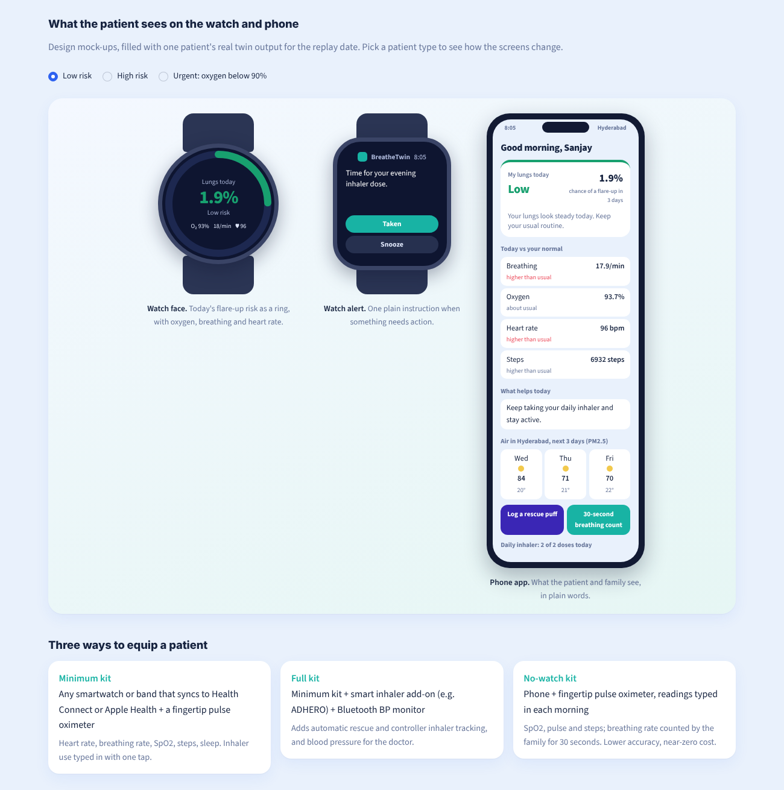
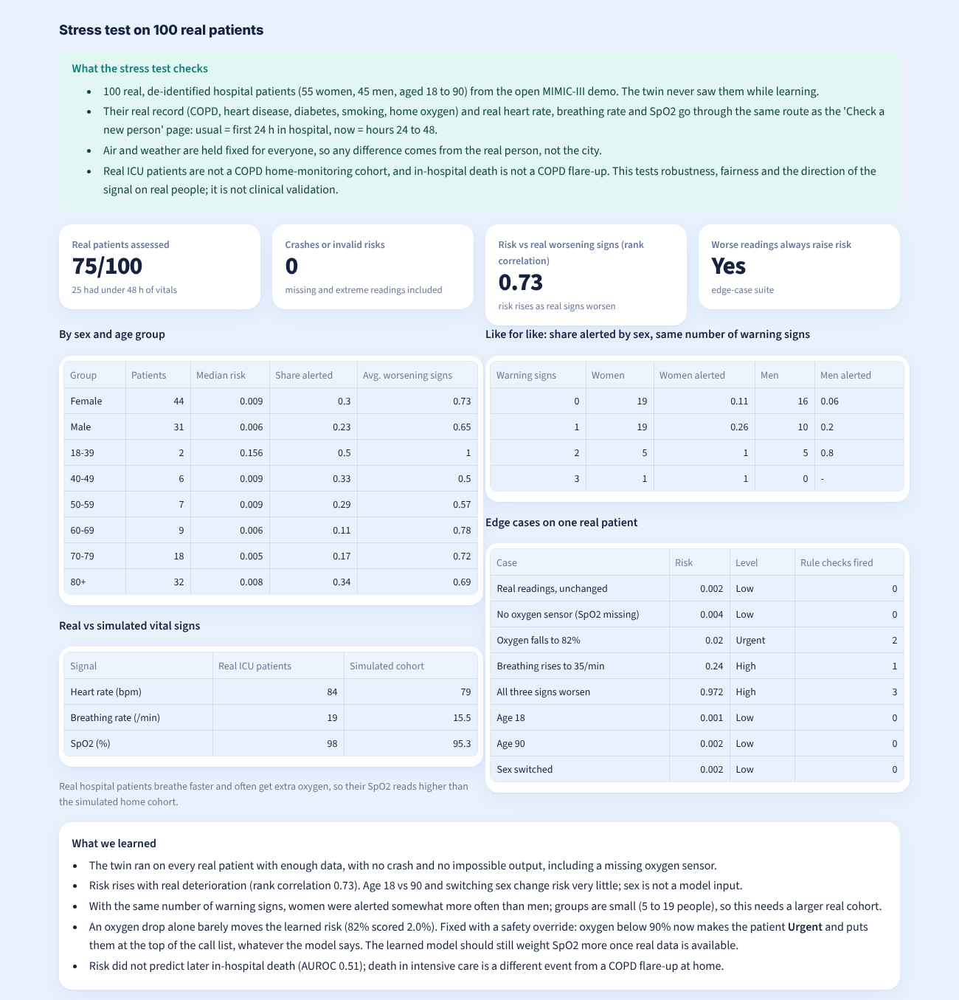
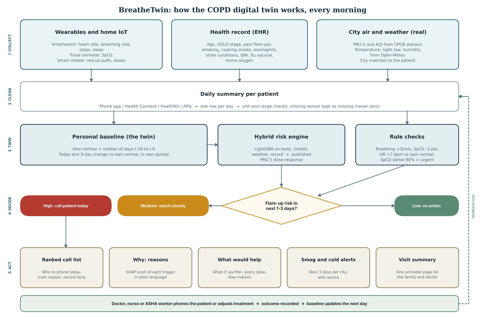
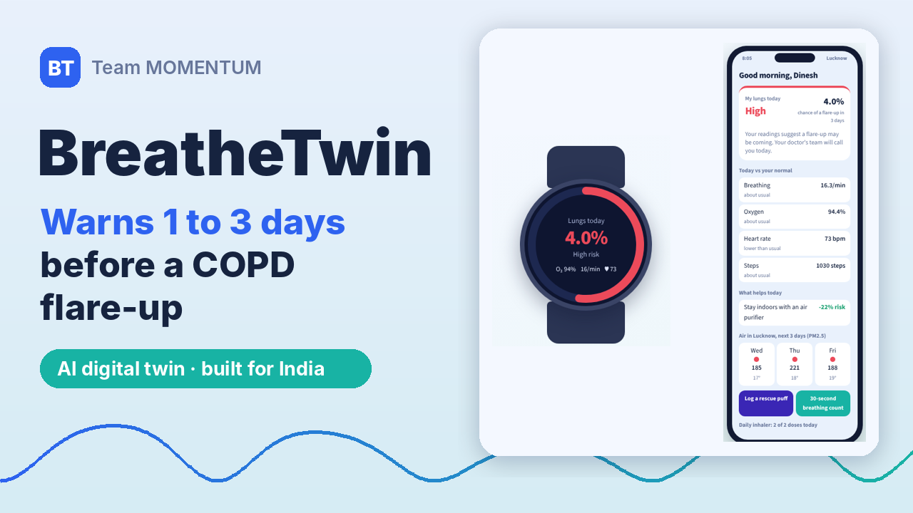

# BreatheTwin: a COPD digital twin for India

Submission to the **Digital Twin Challenge 2026** (Happiest Health, Reimagining & Reforming Healthcare in India Summit).

A digital twin of a COPD patient that learns the patient's own normal, watches their city's air pollution and weather, and warns 1 to 3 days before a likely flare-up, with the reasons, what could lower the risk, and plain advice for the family.

**Try it live (no install needed): https://breathetwin.streamlit.app**

**Watch the demo video (15 min): https://youtu.be/l2pGZtYHCFM**
*(If the app has been idle, Streamlit may show a "wake up" button first; it takes about 30 seconds.)*


---

## Team details

| | |
|---|---|
| Team name | MOMENTUM |
| Team leader | Anushka Tomar |
| Member | Yash Saxena |

## College / incubator information

Both team members: SDA Bocconi Asia Center, Mumbai (MBA, IMB9, Class of 2026-28)

## Project title

BreatheTwin: an environment-aware digital twin that predicts COPD flare-ups for Indian patients

## Problem statement

COPD (chronic obstructive pulmonary disease) is one of India's largest causes of death and disability. In 2016 India had an estimated 55.3 million COPD cases, and ambient air pollution (33.6%) and household air pollution (25.8%) each accounted for more of India's COPD disability than smoking (21.0%) (India State-Level Disease Burden Initiative, Lancet Global Health 2018).

The dangerous event in COPD is the flare-up (acute exacerbation): a few days of worsening breathing that often ends in hospital. The body gives warning signs in the days before: breathing rate, heart rate and blood oxygen drift away from the patient's normal. Today nobody watches these signs between clinic visits, and nobody connects them with the smog or cold snap the patient is living through. In our replay year, Delhi's PM2.5 averaged 104 µg/m³ (about 7 times the WHO daily safe level of 15), and winter air across our 8 cities was 3 times dirtier than monsoon air.

## Healthcare use case

A pulmonologist, physician or community health worker follows a panel of COPD patients who wear a consumer smartwatch, a fingertip pulse oximeter and, optionally, a smart inhaler. Every morning the twin:

1. ranks patients by their risk of a flare-up in the next 3 days, with the main reason and key health-record facts,
2. shows, for each patient, which factors push the risk up or down (breathing above their own normal, missed inhaler doses, a week of smog, a cold snap, the health record),
3. runs transparent checks against the patient's own normal (for example "Breathing +4.0/min above own normal (today)"),
4. estimates what would lower the risk ("stay indoors with an air purifier", "take every inhaler dose"), and says plainly when the risk is already too high for that,
5. warns about smog and cold nights in the next 3 days for each city, with practical advice,
6. produces a one-page visit summary the family can print and take to the doctor,
7. lets anyone check a new person by entering their record, usual readings and readings now.

The aim is a phone call or a treatment adjustment before the hospital visit.

## What the dashboard shows

The dashboard is written for non-medical users too: every page opens with a short "How to read this page" box, risk levels say what to do (Low: no action; Medium: watch closely; High: contact the patient today; Urgent: oxygen below 90%, act now), and the sidebar has a glossary of medical words.

| Page | What it does |
|---|---|
| **Overview: all patients** | Who to call today, ranked by risk, with the main reason and record facts; India map of risk and air; filter by age group; smog and cold warnings for the next 3 days |
| **One patient in detail** | Risk dial, today's readings against own normal, safety checks, what would lower the risk, full health record (EHR), what is pushing the risk, 90-day history, next-3-days advice, downloadable visit summary |
| **What-if lab** | One-click scenarios (smog week, cold snap, stopped inhaler, early warning signs, perfect week) and sliders for body signals, inhaler use, air, weather and the health record |
| **Check a new person** | Enter the record plus usual and current readings (and optionally today's PM2.5 from an AQI app); see the risk, reasons and every value the twin used |
| **Devices and sensors** | Which wearables and home IoT devices feed the twin, which sensor measures which signal, three patient kits, and how a reading travels to the doctor |
| **How it works** | Flowchart, accuracy, how much data is real, the stress test on 100 real patients, data sources and licences, every simulation setting with its source |

| | |
|---|---|
|  |  |
|  |  |
|  |  |
|  |  |

## Functioning flowchart



Every morning, for every patient (PDF: [`docs/flowchart.pdf`](docs/flowchart.pdf)):

1. **Collect** three streams: wearables and home IoT (watch, pulse oximeter, smart inhaler clip), the health record, and the city's real air quality and weather.
2. **Clean** them into one row per patient per day, with unit and range checks. A missing sensor stays missing; it is never read as zero.
3. **Twin**: compare today and the last 3 days with the patient's own normal (days t-28 to t-8). The hybrid risk engine scores the risk of a flare-up in the next 1 to 3 days, and transparent rule checks run alongside.
4. **Decide**: Urgent (oxygen below 90%: a red flag that overrides the model), High (call the patient today), Medium (watch closely) or Low (no action).
5. **Act**: the ranked call list, the reasons, what would lower the risk, smog and cold alerts, and a printable visit summary. The doctor, nurse or ASHA worker acts, the outcome is recorded, and the baseline updates the next day.

## Wearables and IoT devices it works with

No needle, no blood test, nothing under the skin. Every daily reading comes from a watch, a clip-on finger sensor or an inhaler add-on; air and weather come from city sensor networks.

**Which sensor tracks which signal**

| Signal | Sensor | Devices | How often | How the twin uses it |
|---|---|---|---|---|
| Resting heart rate | Optical heart-rate sensor (green-light PPG) | Any smartwatch or band; pulse oximeter | Daily resting value | Change vs own normal |
| Breathing rate | PPG + motion sensor, during sleep | Fitbit, Apple Watch, Galaxy Watch, Garmin | Nightly average | Change vs own normal |
| Blood oxygen (SpO2) | Red and infrared light (pulse oximetry) | Fingertip or ring oximeter; many watches | Morning or overnight | Change vs own normal; urgent below 90% |
| Steps / activity | 3-axis accelerometer | Watch, band or phone | Daily total | Change vs own normal |
| Sleep hours | Accelerometer + heart-rate pattern | Watch or band | Nightly | Change vs own normal |
| Rescue inhaler puffs | Actuation sensor in a clip-on inhaler add-on | ADHERO (Lupin + Aptar, India), Propeller, Hailie; or one tap in the app | Every puff | Puffs vs own normal |
| Controller doses | Same clip-on sensor | Same, or one tap in the app | Every dose | Share taken in 7 days |
| Blood pressure | Cuff pressure sensor (oscillometric) | Omron Bluetooth monitor | Weekly or when unwell | Shown to the doctor; not yet a risk input |
| PM2.5 / AQI | CPCB continuous monitoring stations | City network, read by API | Daily | Published dose-response; smog warnings |
| Temperature, humidity | Weather stations and reanalysis | Open-Meteo API | Daily | Cold-snap and humid-heat triggers |

**Three ways to equip a patient**

| Kit | What it is | What it gives |
|---|---|---|
| Minimum | Any smartwatch or band that syncs to Android Health Connect or Apple Health + a fingertip pulse oximeter | Heart rate, breathing rate, SpO2, steps, sleep; inhaler use with one tap |
| Full | Minimum + smart inhaler add-on (e.g. ADHERO) + Bluetooth BP monitor | Automatic inhaler tracking and blood pressure |
| No-watch | Phone + fingertip oximeter, readings typed in | SpO2, pulse, steps and a 30-second breathing count; near-zero cost |

**How a reading travels:** sensor → Bluetooth → patient's phone app → Health Connect / HealthKit / vendor API (Fitbit Web API, Garmin Health API, OMRON connect) → BreatheTwin daily summary → risk on the doctor's overview the same morning.

Honest note: in this prototype the watch, oximeter and inhaler readings are simulated (or typed in on the "Check a new person" page). The device connections above are the integration plan through each platform's published data interface; air quality and weather are already real. The full device list is in [`src/devices.py`](src/devices.py) and on the dashboard's **Devices and sensors** page.

## How much of the data is real

| Data | Real or synthetic | Size | Used for |
|---|---|---|---|
| City air quality (PM2.5, AQI) | **Real** | 2,928 city-days, 8 cities, CPCB (1 missing day filled) | Training and dashboard |
| Weather (temperature, humidity) | **Real** | 2,928 city-days, Open-Meteo | Training and dashboard |
| Health records | Synthetic | 420 patients (300 Synthea + 120 India overlay, 20 of them under 30) | Training and dashboard |
| Watch, oximeter and inhaler readings | Synthetic | 153,720 patient-days | Training and dashboard |
| Flare-ups | Synthetic | 454 events | Training labels |
| Real hospital patients (stress test) | **Real** | 100 de-identified ICU patients, 47,214 vital-sign readings (MIMIC-III demo) | Testing only, never training |
| Real COPD records (record check) | **Real** | 14 COPD patients (MIMIC-IV demo), aggregate comparison | Testing only |

All of the environment is real; everything about the training patients is simulated. By volume, about 1% of the values the model learned from are real. That is why we added the stress test below.

## How it works

The prototype fuses three data streams. The brief asks for two; we add the environment because in India it is a larger cause of COPD burden than smoking.

| Stream | What it contains | Source | Real or synthetic |
|---|---|---|---|
| Static: health record | Age, sex, COPD type, severity (GOLD stage), smoking, BMI, blood pressure, other conditions, inhaler regimen, home oxygen | [Synthea](https://github.com/synthetichealth/synthea) COPD module, 300 patients aged 52-92 | Synthetic |
| Static: India overlay | 120 younger patients: 100 aged 30-51 (COPD starts earlier in India) and 20 aged 22-29, each with a documented early-onset cause (alpha-1 gene variant, lung damage after tuberculosis, or heavy cooking smoke since childhood); city, cooking-smoke (biomass) exposure, bidi vs cigarette, flare-ups last year, blood eosinophils, SERPINA1 genetic marker, flu vaccination | Written by us | Synthetic, labelled |
| Dynamic: wearables | Daily resting heart rate, breathing rate, SpO2, steps, sleep, BP, rescue and controller inhaler use | Our simulator, calibrated to published studies | Synthetic |
| Dynamic: environment | Daily PM2.5 and AQI for 8 cities | CPCB data via [Kaggle "Air Quality Data in India"](https://www.kaggle.com/datasets/rohanrao/air-quality-data-in-india) (CC0) | **Real** |
| Dynamic: weather | Daily mean and minimum temperature, humidity | [Open-Meteo historical archive](https://open-meteo.com/) (CC BY 4.0) | **Real** |
| Real-data check | 100 de-identified hospital patients, 14 with COPD | [MIMIC-IV Clinical Database Demo v2.2](https://physionet.org/content/mimic-iv-demo/2.2/) (ODbL 1.0) | **Real** |
| Real-patient stress test | 100 de-identified ICU patients (55 women, 45 men, aged 18-90), 16 with COPD, 47,214 real vital-sign readings | [MIMIC-III Clinical Database Demo v1.4](https://physionet.org/content/mimiciii-demo/1.4/) (ODbL 1.0), extract in [`data/raw/mimic3_demo/`](data/raw/mimic3_demo/) | **Real** |

**The cohort (420 patients).** Every adult generation is represented: 20 aged 22-29, 40 aged 30-39, 49 aged 40-49, 62 aged 50-59, 67 aged 60-69, 79 aged 70-79 and 103 aged 80+. Synthea's lung-function value alone would make two thirds of patients GOLD 4, so we keep Synthea's ordering of who is sicker but assign stages in typical clinic shares: GOLD 1/2/3/4 = 18% / 43% / 28% / 11%. 19% currently smoke and 32% are exposed to cooking smoke at home.

**Why patients under 30.** COPD below 30 is uncommon, so a clinician would ask why a 24-year-old has it. Every under-30 patient therefore carries one documented early-onset cause: alpha-1 antitrypsin deficiency (SERPINA1 gene; Stoller and Aboussouan, Lancet 2005), lung damage after past tuberculosis, which is common in India (Byrne et al., Int J Infect Dis 2015), or heavy cooking smoke since childhood (Salvi and Barnes, Lancet 2009). The cause is shown on the patient's health record. The group size (20) and cause shares are our assumptions. These 20 patients were added with their own random seed, so the other 400 records are unchanged.

Cities: Delhi, Lucknow, Patna, Kolkata, Mumbai, Hyderabad, Bengaluru, Chennai. Year replayed: March 2019 to February 2020 (a full set of seasons before the COVID-19 lockdown changed pollution). One India-wide model is trained across all eight cities; a patient from any other city is matched to the nearest monitored city.

**Why the wearable stream is simulated.** We found no open dataset of COPD patients with wearable data and labelled flare-ups. Every effect size in the simulator comes from a published study or is marked as our assumption in [`src/config.py`](src/config.py). Examples:

- Breathing rate +2.3/min two days before and +4.4/min one day before a flare-up; about 30% of flare-ups show no breathing-rate rise (Yañez 2012)
- Flare-up rates of 0.85, 1.34 and 2.00 per year for GOLD 2, 3 and 4 (ECLIPSE, Hurst 2010)
- Blood eosinophils of 340 cells/µL or more: 1.76 times more severe flare-ups (Vedel-Krogh 2016)
- Still smoking vs having quit: 1.28 times the flare-up risk (Au 2009)
- +2.5% risk per 10 µg/m³ PM2.5 (DeVries 2017)
- A 6 °C day-to-day temperature drop raising 21-day risk 1.79 times (Fu 2023)
- Cooking smoke, age, other conditions, low BMI, humidity and missed doses: direction from the literature, size is our assumption (labelled ASSUMPTION)

Health-record factors are rescaled so each GOLD stage keeps its published average flare-up rate; they shift risk between patients, not overall.

## Technical stack

- Python 3.12 or newer, pandas, NumPy
- LightGBM (gradient-boosted trees) and scikit-learn
- Streamlit and Plotly for the dashboard
- Synthea v4 (Java) for synthetic health records
- Matplotlib for result charts and the printable visit summary

## AI/ML model and framework details

- **Task:** for each patient-day, predict whether a flare-up starts in the next 1 to 3 days.
- **Personal baseline (the twin):** for every signal, the patient's own normal is the median of days t-28 to t-8, and the spread is their own standard deviation. Features are deviations from that normal (today and 3-day average), not raw values. A new person checked on the dashboard gets a normal built from the usual readings entered.
- **Features (28 learned + PM2.5 dose-response):** body-signal deviations, rescue-inhaler use vs normal, 7-day controller adherence, cumulative temperature drop over 21 days, minimum temperature, humidity and humid-heat flag, and the health record (age, GOLD stage, past flare-ups, smoking, cooking smoke, eosinophils, other conditions, BMI, flu vaccine, home oxygen).
- **Hybrid risk engine:** a LightGBM classifier learns the body-signal, inhaler, weather and record patterns; the PM2.5 effect is not learned but taken from the published dose-response (DeVries 2017) and applied on the odds scale. Small, well-measured effects come from the literature; complex physiology comes from data.
- **Direction rules:** the model is constrained so warning signs, sharper cold, a sicker record, higher eosinophils, smoking or cooking smoke never lower risk, and taking more inhaler doses never raises it, so every what-if answer moves the sensible way.
- **Explanations:** per-patient SHAP contributions from LightGBM, grouped into plain-language factors ("what is pushing the risk up or down").
- **Rule layer:** transparent checks against the patient's own normal, on both today's reading and the 3-day average, with thresholds set just inside the published average changes.
- **Safety override:** a red-flag rule (oxygen below 90%) makes the patient Urgent and puts them at the top of the call list, whatever the model's probability. Rules catch emergencies; the model catches slow drift.
- **Smog warnings:** the next 3 days of air quality and weather per city, using India's CPCB PM2.5 bands, with advice that gets stronger as air gets worse. In this demo the "forecast" is the real recorded data for those days of 2019-20; a live version would read an air-quality forecast.
- **Validation:** patients split 70/30, so the model is tested on 126 people it never saw (294 used for training).

### Results on held-out patients

| Measure | Value |
|---|---|
| AUROC | 0.815 |
| AUPRC | 0.27 (flare-up days are under 1% of days) |
| Flare-ups warned 1 to 3 days ahead | 67% |
| False alerts per patient per month | 0.91 |
| Published real-world range (AUROC) | 0.68 (Shah 2017) to 0.85 (Hurst 2010) |


What each data stream adds (AUROC): health record alone 0.59, environment alone 0.57, wearables alone 0.818, wearables + health record 0.818, all three 0.815. The body signals carry the 3-day warning, and the health record sets each person's starting risk. Air and weather say little about *which 3 days* a given person will flare up, because their published effects are modest; their value is in *when* risk rises across a season, in the smog warnings and in the what-if advice.

**These results come from simulated data.** They show the pipeline works and the model recovers the patterns the literature describes. They are not clinical accuracy.

### Real-data check (MIMIC-IV demo)

The record-mapping code runs on the real MIMIC-IV demo and finds 14 COPD patients. Comparing them with our synthetic cohort ([`outputs/mimic_demo_check.csv`](outputs/mimic_demo_check.csv)) shows where synthetic records differ from real ones. Sex mix (50% vs 51% male) and ischaemic heart disease (43% vs 44%) match well. Heart failure (57% vs 2%) and diabetes (64% vs 18%) do not: real hospital COPD patients are sicker than synthetic ones. Only aggregate numbers are saved.

### Stress test on 100 real patients (MIMIC-III demo)

The twin was trained only on simulated patients, so we fed it 100 real, de-identified hospital patients it has never seen: 55 women and 45 men, aged 18 to 90, 16 with COPD, from the open [MIMIC-III Clinical Database Demo](https://physionet.org/content/mimiciii-demo/1.4/) (ODbL 1.0). Their real health record (COPD, heart disease, heart failure, diabetes, anaemia, smoking, home oxygen) and real heart rate, breathing rate and SpO2 go in the same way as the dashboard's "Check a new person" page: usual readings = median of the first 24 h in hospital, readings now = median of hours 24 to 48. Air and weather are held fixed for everyone, so any difference comes from the person. Script: [`src/stress_test_real.py`](src/stress_test_real.py); results: [`outputs/stress_test_summary.json`](outputs/stress_test_summary.json) and [`outputs/stress_test_real.csv`](outputs/stress_test_real.csv).

| Check | Result |
|---|---|
| Robustness | 75 of 100 assessed (25 had under 48 h of vitals); 0 crashes, 0 invalid risks, including a missing oxygen sensor |
| Signal direction | Risk rises with real worsening signs (rank correlation 0.73); in the edge-case suite, breathing at 35/min gives High risk and all three signs worse gives 97% |
| Age and sex | Age 18 vs 90 and switching sex barely change risk (sex is not a model input). Women alerted 30%, men 23%; women also showed more warning signs |
| Like for like | With the same number of warning signs, women were alerted somewhat more often than men; groups are 5 to 19 people, so this needs a larger real cohort |
| Realism | Real ICU patients breathe faster (median 19 vs 15.5/min) and often get extra oxygen (SpO2 98% vs 95.3%) than our simulated home cohort |
| Found and fixed | An SpO2 drop alone barely moves the learned risk (oxygen at 82% scored 2.0%, Low). Fixed with the safety override: oxygen below 90% now makes the patient Urgent, and the same case now returns Urgent |
| Limit | Risk did not predict later in-hospital death (AUROC 0.51); death in intensive care is a different event from a COPD flare-up at home |

This is a stress test of robustness, fairness and the direction of the signal on real people, not clinical validation.

### Test on a new patient (shown in the video)

The model was also tested live on a person it had never seen, entered on the **Check a new person** page: a 23-year-old woman in Mumbai, GOLD 2, 3 flare-ups last year, never smoked, eosinophils 320 cells/µL, BMI 19, on a daily inhaler. Usual readings: heart rate 58, breathing 14/min, SpO2 99%, 4,000 steps, 2 rescue puffs, 7 h sleep. Last 3 days: 52, 18/min, 97%, 1,000 steps, 3 puffs, 6.5 h.

| Test case | Result |
|---|---|
| Readings now = usual (default record, 64 yrs, Delhi) | Low, about 0.3% |
| Breathing 16→22/min, SpO2 95→91%, rescue puffs 1→4 | High, about 99% |
| 23-year-old test patient above | **High, about 28%**: breathing +4.2/min and SpO2 -2 points vs her own normal, far fewer steps, one extra rescue puff; under-30 caution shown |

None of her readings is alarming against a textbook range (SpO2 97%), but against her own normal she is drifting. That is the point of a personal twin.

## Demo video

[](https://youtu.be/l2pGZtYHCFM)

**https://youtu.be/l2pGZtYHCFM** (15 min 41 s, unlisted)

| Time | Part |
|---|---|
| 0:00 | Opening and team |
| 1:05 | The problem |
| 2:26 | How the twin works |
| 4:01 | Demo: the doctor's overview |
| 5:37 | Demo: one patient in detail |
| 7:23 | Demo: the safety override (oxygen below 90%) |
| 8:20 | Demo: the what-if lab |
| 9:18 | Demo: testing the model on a new patient |
| 10:57 | Demo: devices and what the patient sees |
| 12:07 | Evidence and honesty |
| 14:20 | Pilot plan and close |

The narration uses AI-generated voices. Full narration: [`docs/video/narration.md`](docs/video/narration.md); captions: [`docs/video/BreatheTwin_captions.en.srt`](docs/video/BreatheTwin_captions.en.srt). The video is rebuilt from this repo by the scripts in [`tools/video/`](tools/video/) (voice, screen recording of the dashboard, assembly).

## Architecture diagram

[`docs/architecture.pdf`](docs/architecture.pdf) · functioning flowchart: [`docs/flowchart.pdf`](docs/flowchart.pdf) (also shown [above](#functioning-flowchart))

## Presentation

[`docs/BreatheTwin_presentation.pdf`](docs/BreatheTwin_presentation.pdf) (PowerPoint version: [`docs/BreatheTwin_presentation.pptx`](docs/BreatheTwin_presentation.pptx))

## Open-source licence

Code: [MIT License](LICENSE). Data keeps its own licence: Synthea output (generated by Apache-2.0 software), CPCB air quality via Kaggle (CC0), Open-Meteo weather (CC BY 4.0, attribution: Open-Meteo.com), MIMIC-IV demo (ODbL 1.0; not stored in this repo, downloaded by the user).

## Run it yourself

Three ways, from easiest to most hands-on. All of them use the data and model already in this repo.

**1. In the browser, nothing to install**

- Hosted version: **https://breathetwin.streamlit.app**
- Or run it from this repo on GitHub's own computers: [](https://codespaces.new/yashsaxena1220-lgtm/MOMENTUM_SDA-Bocconi-Asia-Center?quickstart=1)
  Click the button, then **Create new codespace** (needs a free GitHub account). Then:
  1. If VS Code asks *"Do you trust the authors of the files in this folder?"*, click **Trust Folder & Continue**.
  2. Wait about 3 minutes while it installs, until the terminal shows `Local URL: http://localhost:8501`.
  3. Open the **Ports** tab at the bottom and click the globe icon next to port **8501**. The dashboard opens in a new browser tab.

**2. Download and double-click** (needs [Python 3.12 or newer](https://www.python.org/downloads/))

1. Click the green **Code** button at the top of this page, then **Download ZIP**, and unzip it.
2. Double-click the launcher for your computer:
   - Windows: **`Open BreatheTwin.bat`**
   - Mac: **`Open BreatheTwin (Mac).command`** (if macOS blocks it the first time: right-click it, choose **Open**, then **Open** again)
   - Linux: `bash "Open BreatheTwin (Mac).command"`
3. The first run installs the packages (a few minutes, once). The dashboard then opens at http://localhost:8501.

**3. Command line** (needs Python 3.12 or newer)

```bash
pip install -r requirements.txt
streamlit run app/dashboard.py          # opens the dashboard at http://localhost:8501
```

Any version opens on a specific view if you add it to the address, for example `?page=Patient%20twin&pid=MOM-0198&day=2019-11-05`.

To rebuild everything from the raw data (about 1 minute):

```bash
python run_all.py
```

Optional extras for the rebuild:

1. Download the MIMIC-IV demo zip into `data/raw/` (https://physionet.org/content/mimic-iv-demo/2.2/) to rerun the real-data check. Without it, that step is skipped and the saved comparison is kept.
2. Regenerate the Synthea cohort with the commands in [`synthea/run_synthea.md`](synthea/run_synthea.md). A trimmed copy is already in `data/raw/synthea_csv/`.

## Repository layout

```
app/dashboard.py          dashboard (Streamlit)
Open BreatheTwin.bat      Windows double-click launcher (installs packages on first run)
Open BreatheTwin (Mac).command   Mac/Linux launcher
.devcontainer/            one-click GitHub Codespaces setup
src/config.py             every simulation setting with its source, cohort balance
src/env_data.py           real air quality + weather -> environment_daily.csv
src/ehr_synthea.py        Synthea records + India overlay + younger patients -> patients.csv
src/simulate.py           wearable stream and flare-ups (body, air, weather and record effects)
src/features.py           personal-baseline features
src/engine.py             hybrid risk engine (LightGBM x published PM2.5 effect)
src/train.py              model training, evaluation, charts
src/score_all.py          scores every patient-day for the dashboard
src/twin.py               risk, reasons, rule checks, what-if
src/advisories.py         smog and cold warnings with advice
src/visit_summary.py      printable one-page visit summary
src/mimic_demo.py         real-data check on MIMIC-IV demo
src/stress_test_real.py   stress test on 100 real MIMIC-III demo patients (age and sex diversity)
src/devices.py            compatible wearables and IoT devices, and which sensor gives which signal
src/flowchart.py          draws docs/flowchart.png / .pdf
synthea/                  keep-file and exact Synthea command
data/raw, data/processed  inputs and generated tables (data/raw/mimic3_demo: real de-identified patients, ODbL)
outputs/                  metrics and charts
docs/                     presentation, flowchart, architecture diagram, screenshots
docs/video/               demo video thumbnail, captions and narration
tools/video/              scripts that rebuild the demo video (voice, screen recording, assembly)
```

## Limitations

- Wearable readings and flare-ups are simulated; the model has not seen a real COPD patient's watch data. It has been stress-tested on 100 real hospital patients, which checks robustness and direction, not accuracy.
- Device connections (Health Connect, HealthKit, Fitbit, Garmin, OMRON, ADHERO) are designed but not yet built; readings are simulated or typed in.
- An oxygen drop on its own moves the learned risk too little (found in the stress test). The safety override now makes any reading below 90% Urgent, but the learned model itself should weight oxygen more once real data is available.
- Synthea's COPD cohort is US-based; the India overlay, the younger patients and the stage shares are our assumptions.
- No India-specific effect size linking PM2.5 to COPD flare-ups was found; the 2.5% per 10 µg/m³ figure is a global meta-analysis.
- Cooking smoke, age, other conditions, low BMI, humidity, sleep and missed-dose effects have no published effect size and are marked as assumptions.
- Air quality is city-wide, not the patient's own exposure; the smog "forecast" replays past data.
- The dashboard needs daily readings from a smartwatch or pulse oximeter.

## Next steps

1. **Validate:** partner with a pulmonology clinic; test on real Indian COPD records and wearable data; apply for full MIMIC-IV credentialed access; tune the alert line.
2. **Patient app:** a "My lungs today" view, a daily symptom check-in that works with just a phone and a low-cost pulse oximeter, SMS/WhatsApp alerts, Hindi and regional languages.
3. **Scale:** live air-quality forecasts, link with ABHA/ABDM health records, rollout through community health workers.

## Key references

- Hurst JR et al. NEJM 2010 (ECLIPSE: exacerbation rates by GOLD stage).
- Yañez AM et al. Respir Med 2012, PubMed 22797131 (breathing rate before exacerbation).
- Hurst JR et al. 2010, PMC2978135 (pulse oximetry and heart rate before exacerbation).
- Shah SA et al. JMIR 2017;19(3):e69 (vital-sign prediction of exacerbations).
- Alahmari AD et al. BMC Pulm Med 2014;14:98 (daily steps in COPD exacerbations).
- Vedel-Krogh S et al. Am J Respir Crit Care Med 2016 (blood eosinophils and exacerbations, Copenhagen General Population Study).
- Au DH et al. J Gen Intern Med 2009 (smoking cessation and COPD exacerbation risk).
- Celli BR et al. NEJM 2004 (BODE index; low BMI and outcomes).
- Salvi SS, Barnes PJ. Lancet 2009 (COPD in non-smokers; biomass smoke).
- DeVries R et al. 2017, CDC Stacks 215891 (meta-analysis, PM2.5 and COPD exacerbation).
- Fu J et al. Front Public Health 2023;11:1112926 (temperature drop and COPD admissions, Beijing).
- India State-Level Disease Burden Initiative CRD Collaborators. Lancet Global Health 2018.
- Walonoski J et al. JAMIA 2018 (Synthea).
- Johnson A et al. MIMIC-IV Clinical Database Demo v2.2. PhysioNet 2023, doi:10.13026/dp1f-ex47.
